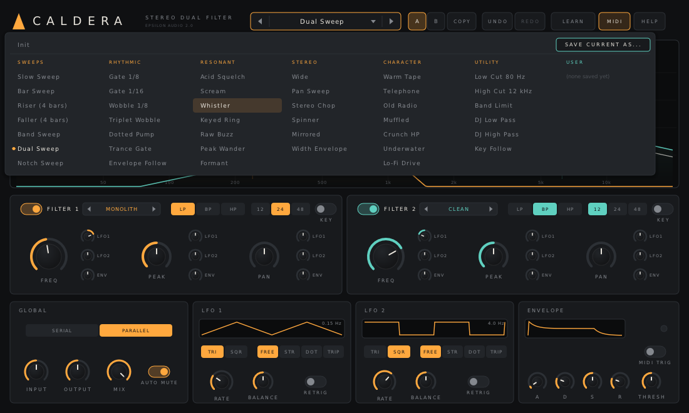
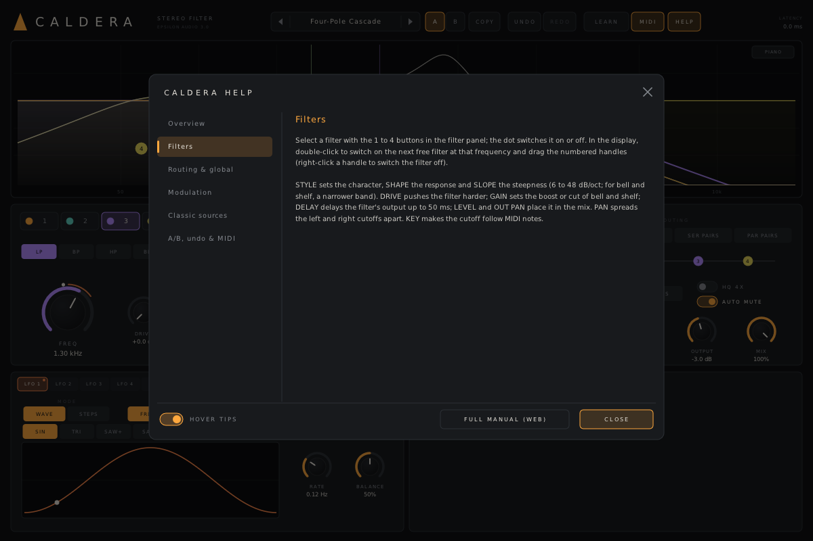

# Caldera

**A stereo filter effect plugin with up to four filters, for macOS, Windows and Linux (VST3 · AU · CLAP · VST2).**

Part of **[Epsilon Audio](https://github.com/natehouk/epsilon-plugins)**, a family of free, open-source plugins: Monolith, Caldera, Obsidian, Strata, Basalt, Gneiss, Mica, Flint, Granite, Magma, Schist, Slate, Talc, Geode and Malachite.


Caldera is a clean-room design with the feature set of FabFilter Volcano 3 (2021). Version 1 followed the original Volcano (2005); version 3 follows Volcano 3. It was written from scratch, working only from FabFilter's public product pages, online help and release announcements. No FabFilter code, binaries, presets, artwork or trademarks were used.

The filters are cascaded topology-preserving state-variable filters (Zavalishin) with Butterworth stage damping; bell, shelf, notch and all-pass shapes are built from the same sections, so each style's published-technique nonlinearity colours them too.

Caldera is the sibling of [Monolith](https://github.com/natehouk/monolith), and Monolith's filter is one of its seven styles.

## Download

Get the latest build from [**Releases**](../../releases):

| Platform | File | Contains |
|---|---|---|
| macOS 10.13+ (Apple Silicon + Intel) | `Caldera-macos-universal.zip` | VST3, AU (MIDI-controlled effect), CLAP, manual |
| Windows x64 | `Caldera-windows-x64.zip` | VST3, CLAP, VST2, manual |
| Linux x64 | `Caldera-linux-x64.zip` | VST3, CLAP, VST2, manual |

### Install

| Platform | Copy | To |
|---|---|---|
| macOS | `Caldera.vst3` / `Caldera.component` / `Caldera.clap` | `~/Library/Audio/Plug-Ins/VST3` / `Components` / `CLAP` |
| Windows | `Caldera.vst3` (folder) / `Caldera.clap` | `C:\Program Files\Common Files\VST3\` / `CLAP\` |
| Linux | `Caldera.vst3` / `Caldera.clap` | `~/.vst3/` / `~/.clap/` |

**macOS:** builds are notarized once the project's Apple signing credentials are set up. Until then they are ad-hoc signed; after copying, run:

```
xattr -dr com.apple.quarantine ~/Library/Audio/Plug-Ins/*/Caldera*
```

**Logic Pro:** to use MIDI features, insert Caldera as an **AU MIDI-controlled effect** on an instrument track. MIDI features are key tracking, MIDI-triggered envelopes, the MIDI modulation sources, LFO retrigger and MIDI Learn.

## Features

**Four filters**
- Each filter can be switched on or off; double-click the display to add one.
- **Eleven styles**, from transparent to self-oscillating:

  | Style | Character |
  |---|---|
  | **Clean** | Linear, high-Q, never self-oscillates |
  | **Smooth** | Gentle, broad resonance |
  | **Warm** | Saturated input into a linear filter |
  | **Monolith** | The Monolith synth's filter: soft-limited, self-oscillating |
  | **Hot** | Saturating integrators, screaming peak |
  | **Acid** | Resonance thins the bass, squelchy |
  | **Raw** | Hard-clipped feedback, buzzy self-oscillation |
  | **Tube** | Asymmetric valve-like drive, even harmonics, singing peak |
  | **Gentle** | Clean and polite, never self-oscillates |
  | **Metal** | Hard-clipped input and feedback: rough and sharp |
  | **Hollow** | The cutoff band is carved out as the peak rises; deep low self-oscillation |

- **Eight shapes:** low pass, band pass, high pass, bell, low shelf, high shelf, notch, all pass, at **6, 12, 24 or 48 dB/oct** (for bell and shelf, the slope sets the bandwidth). The shapes follow the style, so a Hot bell distorts.
- Per filter: **Freq**, **Peak**, **Gain** (bell and shelf), **Drive** (0–24 dB, level-compensated), **Pan** (left/right cutoff spread), **Delay** (0–50 ms, for comb, chorus and Haas effects), **Level**, **Output Pan**, and **KEY** tracking.

**Routing and channels**
- **Serial** (1 → 2 → 3 → 4), **parallel**, **serial pairs** ((1 → 2) beside (3 → 4)) or **parallel pairs** ((1 + 2) into (3 + 4)), with a live diagram.
- **Stereo**, **left/right** (filters 1–2 left, 3–4 right) or **mid/side** (1–2 mid, 3–4 side).
- **HQ:** 4x oversampling (48 samples of latency, reported to the host).
- Input gain and pan, output gain, dry/wet mix (time-aligned with HQ), auto-mute for self-oscillation.

**Modulation** (the shared Epsilon modulation system, as in Magma)
- **50 slots, drag and drop:** drag a source's chip onto any knob. Modulated knobs show their range and a live position; click the ring (or right-click the knob) for a panel listing every slot on it.
- **Sources:** 4 **XLFOs** (7 waves or a 16-step sequencer, free or synced), 2 **envelope generators** (MIDI or audio), 2 **envelope followers** (input or sidechain), 2 **XY pads**, **MIDI** (velocity, key, mod wheel, pitch bend, aftertouch), and per-source **presets** (23 factory, plus your own).
- **Classic sources:** Caldera 2's two LFOs and envelope with their grid, unchanged, so older projects keep working. Their connections show in the slot list.

**Interactive display**
- Every filter's response, the combined response, live modulation markers and an optional **piano keyboard**.
- Drag a numbered handle for frequency and peak (or gain); Alt-drag to move all filters together; right-click to switch a filter off.

**Workflow**
- **57 factory presets** in six categories, user presets as cross-platform text files.
- The preset browser **searches** names and categories as you type, and a star keeps a preset in **Favourites**.
- **A/B** with copy, **undo/redo** for every edit, **MIDI Learn** with saved assignments and a MIDI on/off switch.
- **Hover tips** everywhere, a **HELP window**, and a **[full manual](docs/MANUAL.md)** (also in every release zip as `Caldera-Manual.html`).
- Resizable window; every parameter automatable and smoothed.





### Compared with FabFilter Volcano 3

| Volcano 3 | Caldera 3.0 |
|---|---|
| Up to four filters | ✓ |
| Flexible serial and parallel routing | ✓ serial, parallel and two paired layouts |
| Stereo, per-channel (L/R) and mid/side routing modes | ✓ |
| Low/high/band pass, bell, low/high shelf, notch and all-pass shapes, non-linear | ✓ all shapes follow the style |
| Slopes including 6 dB/oct | ✓ 6, 12, 24, 48 dB/oct |
| Several vintage-style filter characters, self-oscillation and saturation | ✓ eleven original styles |
| Per filter: drive, frequency with stereo pan ring, peak, delay up to 50 ms, output level and pan | ✓ plus key tracking |
| High Quality oversampling | ✓ 4x |
| XLFOs (16-step), envelope generators, envelope followers, MIDI sources, XY controllers | ✓ |
| Drag-and-drop modulation with live visualisation and a floating slot panel | ✓ 50 slots |
| Per-component presets for modulation sources | ✓ |
| Interactive display with optional piano display | ✓ |
| Input and output level/pan, mix, auto-mute self-oscillation | ✓ |
| MIDI Learn, undo/redo, A/B, help with interactive hints | ✓ |
| Loads earlier Volcano presets | Loads Caldera 1.x and 2.x projects and presets, sounding identical |
| Resizable interface, full-screen mode | Freely resizable interface |
| Mono version, AAX, AudioSuite, iPad | Not supported |

## Build from source

The plugin is built on [DPF](https://github.com/DISTRHO/DPF):

```
git clone --recursive https://github.com/DISTRHO/DPF.git dpf
make -C plugins/Caldera                    # Linux / macOS (macOS also builds the AU)
make -C plugins/Caldera WINDOWS=true CC=x86_64-w64-mingw32-gcc CXX=x86_64-w64-mingw32-g++
```

GitHub Actions builds all three platforms on every push. The macOS build is universal. It is signed and notarized when the Developer ID secrets are set (`MACOS_CERT_P12`, `MACOS_CERT_PASSWORD`, `NOTARY_KEY`, `NOTARY_KEY_ID`, `NOTARY_ISSUER`), and ad-hoc signed otherwise. A `v*` tag, or a release published on GitHub, attaches the zips to that release.

## Tests

```
cd tests
g++ -O2 -std=c++17 -I../plugins/Caldera response.cpp -o response && ./response      # every style x pass shape x slope: passband and slope
g++ -O2 -std=c++17 -I../plugins/Caldera features.cpp -o features && ./features      # self-oscillation per style, pan, routing, EG triggers, key tracking, LFO sync, auto-mute
g++ -O2 -std=c++17 -I../plugins/Caldera features2.cpp -o features2 && ./features2   # 3.0: four filters and routings, L/R and M/S, shapes, 6 dB/oct, drive, delay,
                                                                                   # level/pan, HQ latency and aliasing, styles, XLFO/EF/sidechain/slot-on-slot
g++ -O2 -std=c++17 -I../plugins/Caldera compat.cpp -o compat && ./compat            # random 2.x settings through the frozen 2.0 engine and 3.0: identical
g++ -O2 -std=c++17 -I../plugins/Caldera fuzz.cpp -o fuzz && ./fuzz                  # random params/MIDI/transport, loud input, 44.1-192 kHz: finite, <= 0 dBFS
g++ -O2 -std=c++17 -I../plugins/Caldera presets.cpp -o presets && ./presets         # every factory preset on test material
g++ -O2 -std=c++17 -I../plugins/Caldera modpresets.cpp -o modpresets && ./modpresets  # source presets in range, user files round-trip
g++ -O3 -std=c++17 -I../plugins/Caldera bench.cpp -o bench && ./bench               # CPU
```

CI runs all of them except the benchmark on every push, and a release needs them to pass.

CPU use (one core of a cloud build machine, 48 kHz; 48 dB/oct Hot filters with drive, two of them modulated, parallel):

| Filters | Normal | HQ (4x) |
|---|---|---|
| 1 | 3.5% | 10% |
| 2 | 5.8% | 16% |
| 4 | 11% | 35% |

Release checks:
- Steinberg's VST3 validator passes 47/47.
- The interface is exercised with scripted input: filter selection and toggles, the style menu, shapes and slopes, routing and channels, handle drags, drag-and-drop modulation (v2 and classic), the slot panel, HQ, presets, tips and help.

## Source layout

| File | Contents |
|---|---|
| `plugins/Caldera/CalderaEngine.hpp` | All DSP: filter styles and shapes, routing, oversampling, classic LFOs and envelope, modulation. Header-only |
| `plugins/Caldera/ParamDefs.hpp` | Parameter table, labels, value mapping |
| `plugins/Caldera/Presets.hpp` | Factory presets |
| `plugins/Caldera/UserPresets.hpp` | User preset files |
| `plugins/Caldera/ComponentPresets.hpp` | Factory and user presets for single modulation sources |
| `plugins/Caldera/common/` | Shared Epsilon Audio code (oversampling, modulation system v2), vendored from epsilon-common |
| `plugins/Caldera/Help.hpp` | Hover tip text and in-plugin help pages |
| `plugins/Caldera/CalderaPlugin.hpp/.cpp` | Plugin wrapper: parameters, programs, MIDI, MIDI Learn, transport, latency, sidechain |
| `plugins/Caldera/CalderaUI.cpp` | Custom vector interface (NanoVG) |
| `docs/MANUAL.md` | User manual (`Caldera-Manual.html` is generated from it with pandoc) |
| `tests/legacy/` | Frozen copy of the 2.0 engine, for the compatibility test |

New parameters are only ever appended, so saved sessions and automation keep working across versions.

## Changelog

- **3.1:** the preset browser searches names and categories as you type, and keeps Favourites.
- **3.0:** Brings Caldera up to Volcano 3. New in this version:
  - Four filters, with serial, parallel and two paired routings, in stereo, left/right or mid/side.
  - Bell, shelf, notch and all-pass shapes; a 6 dB/oct slope.
  - Four new styles: Tube, Gentle, Metal and Hollow (eleven in all).
  - Per-filter drive, gain, delay, level and output pan; input pan.
  - 4x HQ mode.
  - The shared modulation system (XLFOs, envelopes, followers with a sidechain input, XY pads, MIDI, 50 slots, per-source presets, a slot panel on every modulated knob). Caldera 2's LFOs and envelope stay, under CLASSIC.
  - Piano display; sixteen new presets (57).
  - A new 1200 x 800 interface. The display's centre link handle is replaced by Alt-drag (all filters together).

  Sessions, automation, presets and MIDI Learn maps from 1.x and 2.x load and sound the same; a test checks this against the frozen 2.0 engine. The Style, Type, Slope and Routing parameters gained values at the end of their ranges: in hosts that store automation as a 0-1 position, check those lanes after upgrading.

- **2.0:** A/B with copy, undo/redo, hover tips, a help window and a full manual (in every release zip), rim-grab turning on the large knobs. Sessions and automation from 1.x load unchanged.
- **1.0:** First release.

## License

[MIT](LICENSE). Built with [DPF](https://github.com/DISTRHO/DPF) and its bundled NanoVG, which are under the ISC license. `plugins/Caldera/ResizeHandle.hpp` comes from DPF's examples and keeps its ISC notice.

"FabFilter" and "FabFilter Volcano" are trademarks of FabFilter Software Instruments. Caldera is not affiliated with or endorsed by FabFilter.
