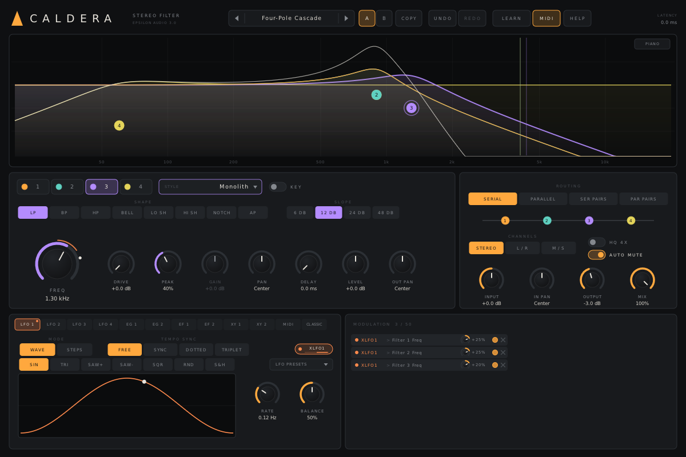

# Caldera 3.0 — User Manual

Caldera is a stereo filter effect with up to four filters. Each filter has its own style (from clean to screaming), shape (low pass, band pass, high pass, bell, shelves, notch, all pass), slope, drive, delay, level and pan. The filters connect in series, in parallel or in pairs, and in stereo, left/right or mid/side. A drag-and-drop modulation system moves almost every control. Typical uses:

- filter sweeps, risers and fallers
- rhythmic, tempo-synced filter movement and gating
- resonant, singing and self-oscillating tones
- character EQ that distorts, phasing, comb filtering, chorus and Haas widening
- stereo movement, mid/side treatment and width

Caldera runs as VST3, AU, CLAP and VST2 on macOS, Windows and Linux.

**New in 3.0:** four filters (from two), four routings, left/right and mid/side processing, bell, shelf, notch and all-pass shapes, a 6 dB/oct slope, four new styles (eleven in all), per-filter drive, gain, delay, level and output pan, input pan, a 4x HQ mode, a piano keyboard under the display, and the modulation system of Magma 2 (XLFOs with 16-step sequencers, envelopes, envelope followers with a sidechain input, XY pads, MIDI sources, 50 drag-and-drop slots and per-source presets). The two LFOs and the envelope of Caldera 2 are still there, under **CLASSIC**. Projects made with Caldera 1.x and 2.x load and sound exactly as before (see [Compatibility](#16-compatibility-with-1x-and-2x)).

**Contents**

1. [Installing](#1-installing)
2. [A quick tour](#2-a-quick-tour)
3. [The filters](#3-the-filters)
4. [Styles](#4-styles)
5. [Shapes and slopes](#5-shapes-and-slopes)
6. [Routing and channels](#6-routing-and-channels)
7. [Global controls](#7-global-controls)
8. [The display](#8-the-display)
9. [Modulation](#9-modulation)
10. [Modulation sources](#10-modulation-sources)
11. [Knobs, A/B, undo and MIDI](#11-knobs-ab-undo-and-midi)
12. [Presets](#12-presets)
13. [Recipes](#13-recipes)
14. [Parameter reference](#14-parameter-reference)
15. [Troubleshooting](#15-troubleshooting)
16. [Compatibility with 1.x and 2.x](#16-compatibility-with-1x-and-2x)

---

## 1. Installing

Download the zip for your system from the project's **Releases** page and copy the plugin files:

| System | Copy | To |
|---|---|---|
| macOS | `Caldera.vst3`, `Caldera.component` (AU), `Caldera.clap` | `~/Library/Audio/Plug-Ins/VST3`, `.../Components`, `.../CLAP` |
| Windows | the `Caldera.vst3` folder, `Caldera.clap` | `C:\Program Files\Common Files\VST3\`, `...\CLAP\` |
| Linux | `Caldera.vst3`, `Caldera.clap` | `~/.vst3/`, `~/.clap/` |

**macOS:** if the build isn't notarized and macOS blocks it, open Terminal and run:

```
xattr -dr com.apple.quarantine ~/Library/Audio/Plug-Ins/*/Caldera*
```

Rescan plugins in your DAW. Caldera appears under **Epsilon Audio** as an effect.

**Logic Pro:** to use the MIDI features (key tracking, MIDI-triggered envelopes, MIDI sources, LFO retrigger, MIDI Learn), insert Caldera as an **AU MIDI-controlled effect** on an instrument track.

**Sidechain:** Caldera 3.0 has a stereo sidechain input for its envelope followers. Route another track to it in your DAW.

---

## 2. A quick tour



- **Header:** preset browser, A/B and COPY, UNDO/REDO, LEARN (MIDI Learn), MIDI on/off, HELP, and the current latency at the far right.
- **Display:** every filter's response in its colour, the combined response in white, a numbered handle per filter, live markers where modulation moves each cutoff, and the **PIANO** switch.
- **Filter panel:** the four filter buttons (the dot switches a filter on or off), STYLE, KEY, SHAPE, SLOPE and the knobs of the selected filter.
- **Global panel:** ROUTING (with a diagram), CHANNELS, HQ 4X, AUTO MUTE, INPUT, IN PAN, OUTPUT and MIX.
- **Modulation sources** (bottom left): tabs for each source, its editor and its chip(s) to drag onto knobs.
- **Modulation slots** (bottom right): every modulation connection.

---

## 3. The filters

Caldera has four filters. Click **1** to **4** in the filter panel to edit one; click the **dot** on a button to switch that filter on or off. In the display you can also double-click to switch on the next free filter at that frequency, and right-click a handle to switch it off.

| Control | What it does |
|---|---|
| **STYLE** | The filter's character (see [Styles](#4-styles)) |
| **KEY** | Key tracking: the cutoff follows MIDI notes; FREQ is the cutoff at middle C |
| **SHAPE** | LP, BP, HP, BELL, LO SH, HI SH, NOTCH, AP (see [Shapes](#5-shapes-and-slopes)) |
| **SLOPE** | 6, 12, 24 or 48 dB/oct |
| **FREQ** | Cutoff or centre frequency, 20 Hz – 20 kHz |
| **DRIVE** | Drives the filter harder, 0 – 24 dB, from clean to gritty. The level is largely compensated. Clean and Smooth stay clean |
| **PEAK** | Resonance; most styles self-oscillate near the top. For bell, shelf, notch and all pass it narrows the band |
| **GAIN** | Boost or cut for bell and shelf shapes, ±24 dB |
| **PAN** | Stereo frequency spread: the left and right cutoffs move apart, up to 2 octaves each (stereo only) |
| **DELAY** | Delays the filter's output, 0 – 50 ms |
| **LEVEL** | The filter's output level, ±24 dB |
| **OUT PAN** | Pans the filter's output (stereo only) |

Filters that are off are skipped: in series the signal passes through, in parallel they drop out of the mix.

---

## 4. Styles

| Style | Character |
|---|---|
| **Clean** | Linear, high-Q; never self-oscillates. No drive or clipping at all |
| **Smooth** | Gentle and broad, with a soft, wide resonance |
| **Warm** | Saturated input into a linear filter |
| **Monolith** | The Monolith synth's filter: soft-limited, self-oscillating |
| **Hot** | Saturating integrators, screaming peak |
| **Acid** | Resonance thins the bass; squelchy |
| **Raw** | Hard-clipped feedback, buzzy self-oscillation |
| **Tube** *(3.0)* | An asymmetric, valve-like input: warm overdrive, mostly even harmonics, a soft singing peak |
| **Gentle** *(3.0)* | Clean, polite and broad; general purpose; never self-oscillates |
| **Metal** *(3.0)* | Hard-clipped input and feedback: rough, sharp, distorted |
| **Hollow** *(3.0)* | The band at the cutoff is carved out as the peak rises: hollow, nasal; deep low self-oscillation |

The style applies to every shape, so a Hot bell or a Metal shelf distorts like the low pass does.

---

## 5. Shapes and slopes

| Shape | What it does |
|---|---|
| **LP / BP / HP** | Low pass, band pass, high pass |
| **BELL** | Boosts or cuts around FREQ by GAIN. PEAK and SLOPE make the band narrower |
| **LO SH / HI SH** | Boost or cut everything below / above FREQ by GAIN |
| **NOTCH** | Removes a narrow band; PEAK narrows it |
| **AP** | All pass: the level stays flat, only the phase turns. Alone it sounds the same; with MIX below 100%, or beside another filter in parallel, it makes phasing |

**SLOPE:** 6, 12, 24 or 48 dB/oct. 6 dB/oct is a gentle one-pole filter without resonance. For band pass and notch, 6 dB/oct works like 12. For bell and shelf shapes a steeper slope gives a narrower band; 6 dB/oct is the widest bell.

---

## 6. Routing and channels

**ROUTING** (the diagram below the buttons shows the current layout):

| Routing | Signal path |
|---|---|
| **SERIAL** | 1 → 2 → 3 → 4 |
| **PARALLEL** | all four filters get the input; their outputs are mixed |
| **SER PAIRS** | (1 → 2) beside (3 → 4), mixed |
| **PAR PAIRS** | (1 + 2) into (3 + 4) |

**CHANNELS:**
- **STEREO:** every filter processes both channels.
- **L / R:** filters 1 and 2 process the left channel, 3 and 4 the right. Within each pair, the routing is serial (SERIAL, SER PAIRS) or parallel (PARALLEL, PAR PAIRS).
- **M / S:** the same with mid (centre) and side (stereo difference). For example, a high pass on the side only tightens the low end of a wide mix.

PAN and OUT PAN apply in STEREO only.

---

## 7. Global controls

- **HQ 4X:** runs the filters and their saturation at 4x oversampling. Less aliasing with high drive and resonance, at about three times the CPU, with 48 samples of latency (reported to your DAW and shown at the top right).
- **AUTO MUTE:** silences self-oscillation 50 ms after the input goes quiet.
- **INPUT** (±24 dB) drives the saturating styles; **IN PAN** turns the left or right input down; **OUTPUT** (±24 dB); **MIX** dry/wet. The dry signal is kept in time with HQ's latency.

---

## 8. The display

- Each filter is drawn in its colour; the selected one is brighter. The white curve is the combined response for the current routing (two curves in L/R and M/S).
- **Drag a handle:** left/right sets FREQ; up/down sets PEAK, or GAIN for bell and shelf shapes. Shift-drag for fine control; the mouse wheel over a handle changes PEAK or GAIN.
- **Alt-drag a handle** to move every filter that is on together (frequencies keep their ratios). **Alt-drag a filter knob** to turn the same knob on every filter.
- **Double-click** an empty spot to switch on the next free filter there; **right-click** a handle to switch that filter off.
- Thin vertical lines show where modulation has moved each cutoff right now.
- **PIANO** shows a keyboard under the curves, so you can line filters up with notes.

---

## 9. Modulation

1. Choose a source in the tabs at the bottom left.
2. Drag its **chip** onto any knob. While you drag, valid targets are circled and the status line names the destination.
3. A **slot** appears in the list at the bottom right: source (click to change), destination (click to choose from every target), amount (turn left to invert; Cmd/Ctrl-click resets), bypass (the dot) and delete (the ×).

Up to **50** slots. A slot's amount can itself be modulated: drop a chip on a slot's amount knob.

Modulated knobs get a coloured **ring** showing the range, and a white **dot** where the modulation has taken them. **Click the ring, or right-click the knob,** to open a panel listing every slot (and classic connection) that moves it, with amount, bypass and delete.

Amounts are relative to each control's full range; for FREQ, ±100% covers the whole 20 Hz – 20 kHz range.

**Targets:** every filter's DRIVE, FREQ, PEAK, GAIN, PAN, DELAY, LEVEL and OUT PAN; INPUT, OUTPUT and MIX; XLFO rates and balances; envelope stages; slot amounts.

---

## 10. Modulation sources

| Source | Controls | Notes |
|---|---|---|
| **XLFO 1–4** | MODE (Wave/Steps), WAVE, RATE or tempo DIVISION, BALANCE, GLIDE, STEPS | Seven waves or a 16-step sequencer you draw; free or synced (straight, dotted, triplet) |
| **EG 1–2** | TRIGGER (MIDI/Audio), ATTACK, DECAY, SUSTAIN, RELEASE, THRESHOLD | Audio: starts when the input crosses the threshold |
| **EF 1–2** | LISTENS TO (Input/Sidechain), ATTACK, RELEASE, GAIN | Follows the input or the sidechain level |
| **XY 1–2** | the pad | Two sources each, X and Y |
| **MIDI** | — | Velocity, Key, Mod Wheel, Pitch Bend, Aftertouch |
| **CLASSIC** | LFO 1, LFO 2, ENVELOPE | Caldera 2's sources, unchanged (see below) |

**Source presets:** XLFOs, EGs and EFs have a **PRESETS** menu at the top right of their editor that loads or saves a setting for that one source (11 LFO, 6 envelope and 6 follower presets, plus your own, stored in `LFO`, `Envelope` and `Follower` folders inside the preset folder).

**Classic sources:** the two triangle/square LFOs (free or synced, with BALANCE and RETRIG) and the ADSR envelope (audio threshold or MIDI) of Caldera 2. Their chips reach FREQ, PEAK and PAN of filters 1 and 2, as Caldera 2's grid did; those connections appear in the slot list as **classic rows** (marked 2.X). A classic connection adds to any slots on the same knob. Classic FREQ amounts span ±4 octaves.

---

## 11. Knobs, A/B, undo and MIDI

- **Knobs:** drag up or down (Shift for fine), or grab the rim of a large knob; mouse wheel; double-click to type (`1.2k`, `L40`, `-6`, `250ms`); Cmd/Ctrl-click resets.
- **A / B** hold two complete settings; **COPY** copies the current one to the other slot. Every edit is an undo step (Cmd/Ctrl-Z, Cmd/Ctrl-Shift-Z or Cmd/Ctrl-Y).
- **MIDI Learn:** click LEARN, click a control, move a controller; right-click a control to unassign; CLEAR ALL ASSIGNMENTS removes them all. Assignments are saved with the project.
- **MIDI notes** drive KEY tracking, the Velocity and Key sources and can trigger envelopes; CC1 drives the Mod Wheel source unless learned for something else. The **MIDI** button switches all MIDI handling off.
- **Help:** hover over anything for a tip; **HELP** opens the help pages; **FULL MANUAL (WEB)** opens this manual.

---

## 12. Presets

57 factory presets in six groups, plus your own. Presets new in 3.0 are listed second in each row.

| Group | Presets |
|---|---|
| Sweeps | Slow Sweep, Bar Sweep, Riser (4 bars), Faller (4 bars), Band Sweep, Dual Sweep, Notch Sweep; *3.0:* Four-Pole Cascade, Step Sweep |
| Rhythmic | Gate 1/8, Gate 1/16, Wobble 1/8, Triplet Wobble, Dotted Pump, Trance Gate, Envelope Follow; *3.0:* Sidechain Duck, Comb Chorus |
| Resonant | Acid Squelch, Scream, Whistler, Keyed Ring, Raw Buzz, Peak Wander, Formant; *3.0:* Hollow Drone, Metal Shriek, Tube Singer |
| Stereo | Wide, Pan Sweep, Stereo Chop, Spinner, Mirrored, Width Envelope; *3.0:* Mid/Side Split, Left/Right Ping, Haas Widener |
| Character | Warm Tape, Telephone, Old Radio, Muffled, Crunch HP, Underwater, Lo-Fi Drive; *3.0:* Tube EQ, Telephone Plus, HQ Screamer |
| Utility | Low Cut 80 Hz, High Cut 12 kHz, Band Limit, DJ Low Pass, DJ High Pass, Key Follow; *3.0:* Hum Notch, Gentle Tilt, Phase Rotator |

- Click the preset name to open the browser; **◀ ▶** or the mouse wheel over the name step through presets. A `*` means you have changed the setting.
- **SAVE CURRENT AS…** stores your own presets (plain text, the same on every system) in:
  - macOS: `~/Library/Audio/Presets/Epsilon Audio/Caldera`
  - Windows: `%APPDATA%\Epsilon Audio\Caldera\Presets`
  - Linux: `~/.config/epsilon-audio/caldera/presets`
- To delete one, right-click it in the browser and click again to confirm.

---

## 13. Recipes

- **Classic sweep:** one low pass, Monolith or Hot, an XLFO slowly on FREQ (see Slow Sweep, Four-Pole Cascade).
- **Sidechain-ducked filter:** EF 1 listening to the sidechain, on FREQ with a negative amount; route the kick to Caldera's sidechain (Sidechain Duck).
- **Phaser-like movement:** two all-pass filters in parallel, MIX around 50%, an XLFO on one FREQ (Phase Rotator).
- **Comb and chorus:** two filters in parallel, a few ms of DELAY on one, modulated slowly (Comb Chorus).
- **Haas widening:** two filters in parallel panned apart, 10–20 ms DELAY on one (Haas Widener).
- **Tighten a wide mix:** M / S, a high pass on the side pair (Mid/Side Split).
- **Character EQ:** Tube shelves with a little DRIVE (Tube EQ).
- **Remove hum:** notches at 50, 100 and 150 Hz (Hum Notch; use 60/120/180 Hz in 60 Hz countries).

---

## 14. Parameter reference

There are 422 parameters, all automatable except the read-only outputs. New parameters are only ever added at the end, so sessions and automation keep working across versions.

- **Filters 1 and 2 (2.x order):** On, Style, Type (shape), Slope, Freq, Peak, Pan, MIDI (key).
- **Global (2.x):** Routing, Input Gain, Output Gain, Mix, Auto Mute.
- **Classic LFO 1–2:** Wave, Balance, Sync, Rate (0.01–100 Hz), Division, MIDI Retrigger.
- **Classic envelope:** Attack, Decay, Sustain, Release, Threshold, MIDI Trigger; the 18 classic modulation amounts; MIDI.
- **3.0:** Channel Mode, High Quality; for filters 1–4 Drive (0–24 dB), Gain (±24 dB), Delay (0–50 ms), Level (±24 dB), Output Pan; filters 3 and 4 On … MIDI; XLFO 1–4 (Mode, Wave, Rate, Sync, Division, Balance, Glide, Steps, Step 1–16); EG 1–2; EF 1–2; XY 1–2; Slot 1–50 (Source, Destination, Amount, Bypass); Input Pan; Piano Display.

---

## 15. Troubleshooting

- **Caldera doesn't appear in my DAW.** Check the install folders above and rescan. On macOS, run the `xattr` command from section 1.
- **A ringing tone keeps going.** PEAK is high and AUTO MUTE is off. Lower PEAK or turn AUTO MUTE on.
- **The sidechain follower doesn't move.** Route a track to Caldera's sidechain input and set the EF's LISTENS TO to SIDECHAIN.
- **PAN or OUT PAN does nothing.** They work in STEREO only.
- **GAIN does nothing.** It applies to bell and shelf shapes.
- **CPU is high.** HQ with four steep, saturating filters is the most expensive setting (about a third of a core); switch HQ off while mixing.

---

## 16. Compatibility with 1.x and 2.x

- Projects, automation, presets and MIDI Learn maps from 1.x and 2.x load unchanged, and they sound **identical**: with only filters 1 and 2 and the 2.x settings in use, Caldera 3.0 runs the 2.x signal path. The test suite checks this on every build by playing random 2.x settings, MIDI and tempo changes through a frozen copy of the 2.0 engine and through 3.0, and requiring the outputs to match to better than −120 dB.
- The Style, Type, Slope and Routing parameters gained values at the end of their ranges. In hosts that store automation as a 0–1 position, check automation of those four parameters after upgrading.
- Caldera 3.0 adds a sidechain input bus. Hosts treat it as an optional extra input.
- Going back is not supported: a 3.0 project that uses new features loads in 2.x without them.
